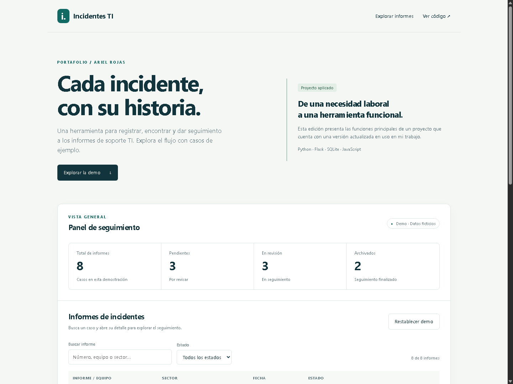

# Gestor de informes de incidentes TI

**Del registro de un incidente a su seguimiento, en un solo lugar.**

Desarrollé esta aplicación para organizar informes de soporte TI, asociar sus documentos y mantener un historial de lo que ocurre con cada caso. El proyecto nace de una necesidad de mi entorno laboral y cuenta con una versión actualizada que se utiliza en mi trabajo.

Esta es su edición pública de portafolio, preparada con información ficticia para mostrar el funcionamiento sin exponer datos internos.

## Qué problema resuelve

Cuando los informes y sus documentos están dispersos, es más difícil encontrar un caso, conocer su estado o revisar los cambios realizados. La aplicación reúne esa información y permite consultarla desde una interfaz en español.

## Qué permite hacer

- **Registrar un incidente** con su fecha, sector, equipo, responsable y documento PDF.
- **Encontrar informes** mediante búsquedas y filtros por estado.
- **Dar seguimiento** a los casos pendientes, en revisión y archivados.
- **Consultar el historial** de cambios de cada informe.
- **Ver estadísticas** sobre los informes y la actividad registrada.
- **Asignar permisos** de administrador, editor o lector según las tareas de cada usuario.

La cuenta `user.demo` puede ver el dashboard y crear, consultar, editar y eliminar informes. La administración de usuarios, las estadísticas y el historial de auditoría son exclusivos del administrador. Las contraseñas de las cuentas locales no se publican.

## Demo interactiva

[**Explorar la demo →**](https://arojases.github.io/Incidentes/)

La demo permite buscar informes ficticios, abrir su detalle, simular un cambio de estado y ver cómo se actualiza el resumen. Funciona sin cuenta ni contraseña y puedes restablecer los ejemplos en cualquier momento.

> El enlace estará disponible cuando se active GitHub Pages en este repositorio. También puedes abrir [docs/index.html](docs/index.html) directamente en tu navegador. La demo es una simulación de las funciones principales; la aplicación completa incluye usuarios, PDF y auditoría en el servidor.

## Mi aporte

Trabajé en el flujo de registro y consulta, la organización de los datos, la interfaz, los permisos de usuario y el seguimiento de cambios. El proyecto muestra cómo llevé una necesidad de soporte TI a una herramienta funcional y cómo preparé una edición pública con ejemplos que cualquier persona puede explorar.

Para esta publicación también incorporé un inicio con doble clic, datos de demostración reproducibles y pruebas de acceso y permisos.

## Probar la aplicación completa

En Windows, con **Python 3.11 o superior** instalado, abre `iniciar_aplicacion.bat`. El programa prepara el entorno, genera ejemplos si es la primera ejecución y abre el navegador. La preparación inicial requiere internet.

Las instrucciones de acceso, configuración y pruebas están en la [guía de instalación](docs/INSTALACION.md).

Para subir esta edición manualmente y activar la demo, sigue la [guía de publicación](docs/PUBLICACION.md).

## Tecnologías

Python · Flask · SQLite · HTML · CSS · JavaScript

## Sobre esta edición

Los ejemplos son ficticios. El repositorio no incluye la base de datos de uso laboral, documentos internos, contraseñas ni configuración privada. La versión laboral evoluciona de forma independiente.

Desarrollado por **Ariel Rojas** · [GitHub](https://github.com/arojases)
